## Cvicenie 3 - REST API (Employee)
Test in Postman (`GET` http://localhost:8080/api/employees)

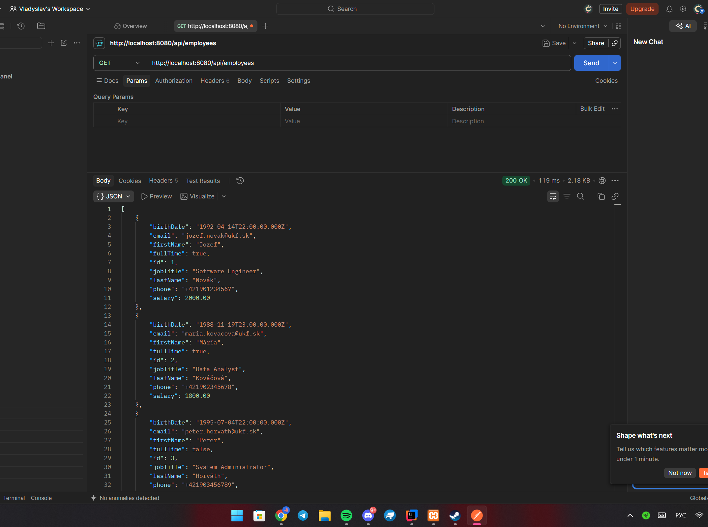

---

## Cvicenie 4 - REST API (Student - Data Mapper)

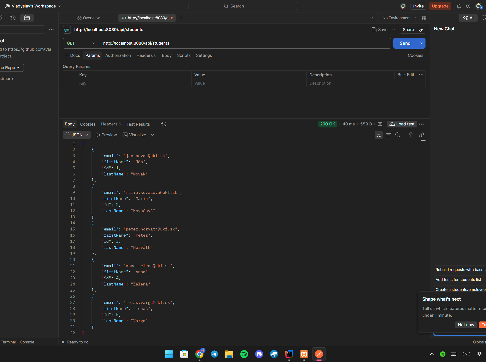
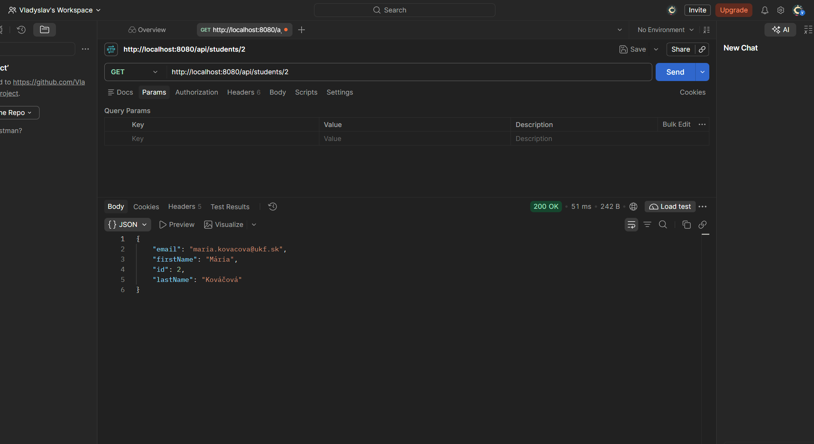
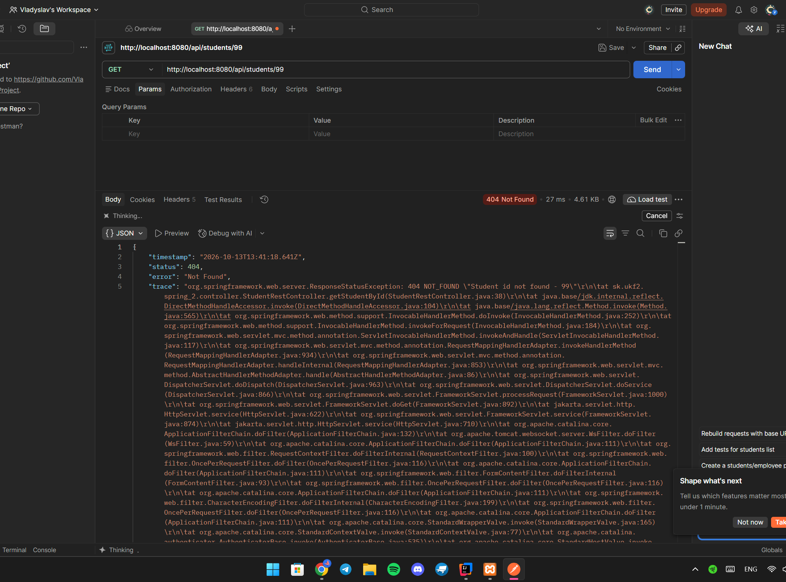
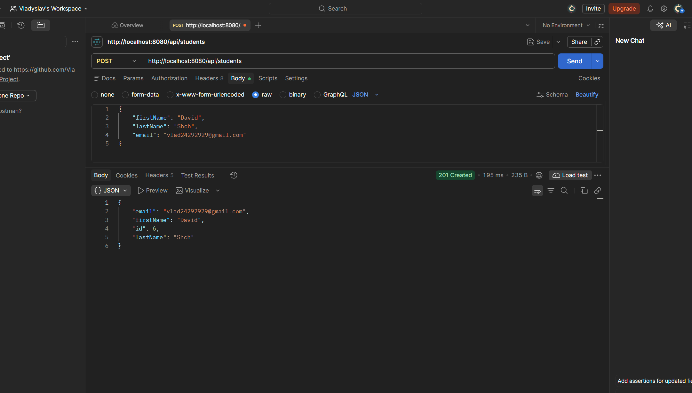
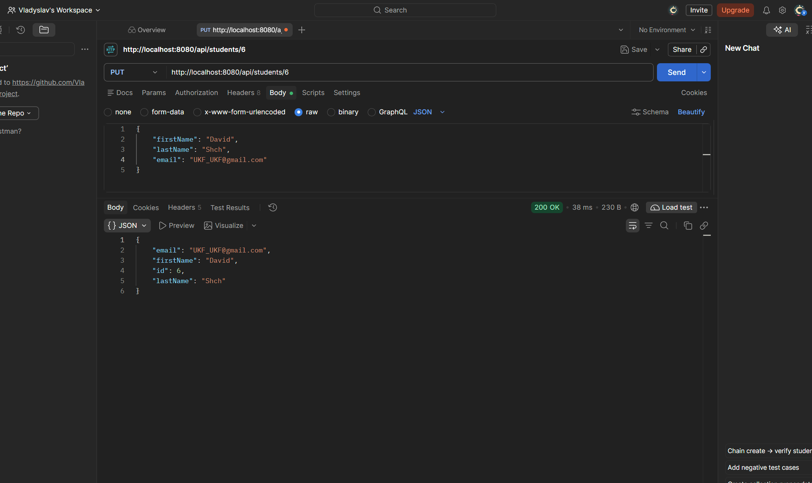
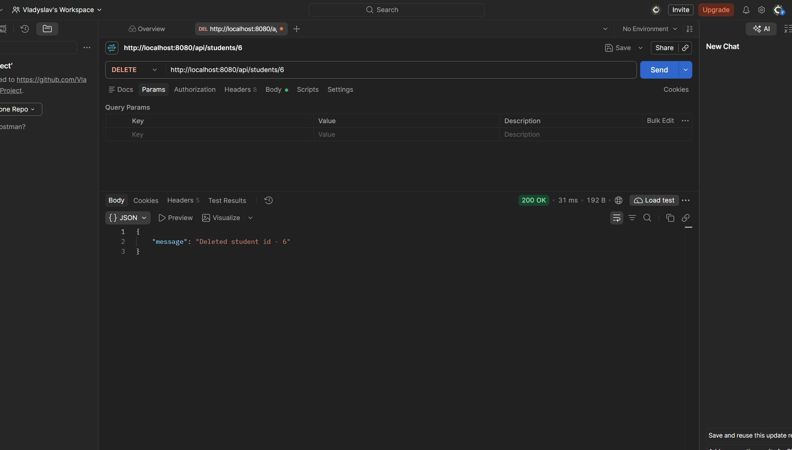
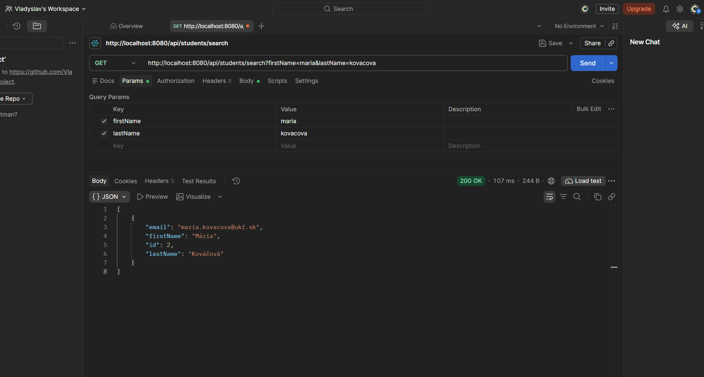

### Spring Data JPA (Student)

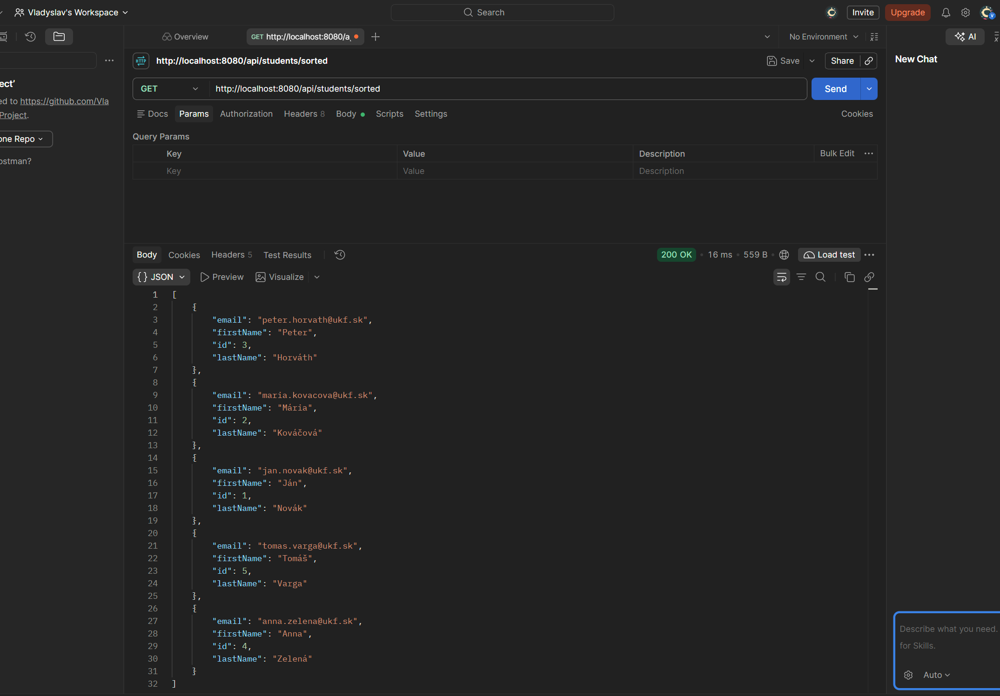

### Swagger UI (Import JSON in POSTMAN)

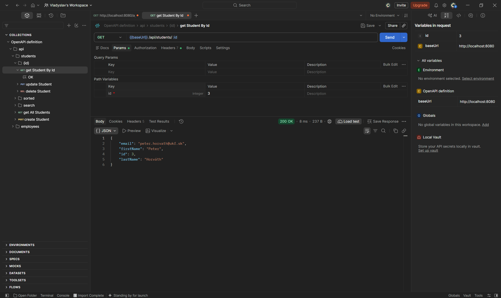

### Zadanie 3 – Adresár zamestnancov (Spring Data JPA & REST API)

- 1. Získanie všetkých zamestnancov (`GET /api/employees`)
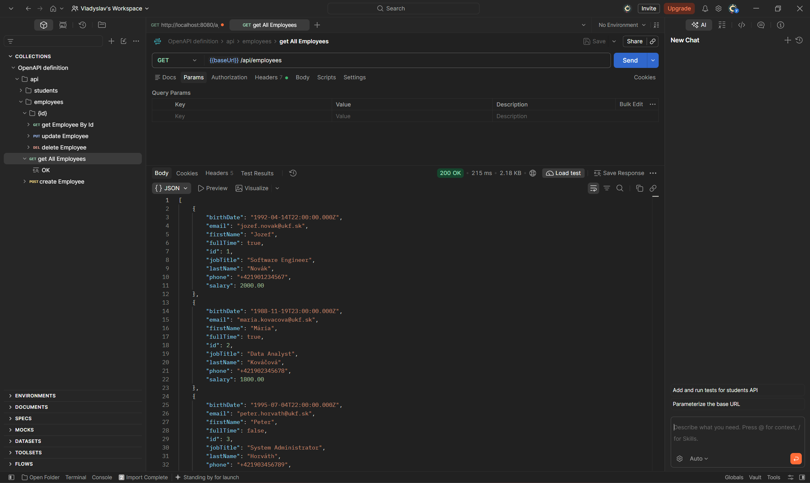

- 2. Získanie zamestnanca podľa ID (`GET /api/employees/{id}`)
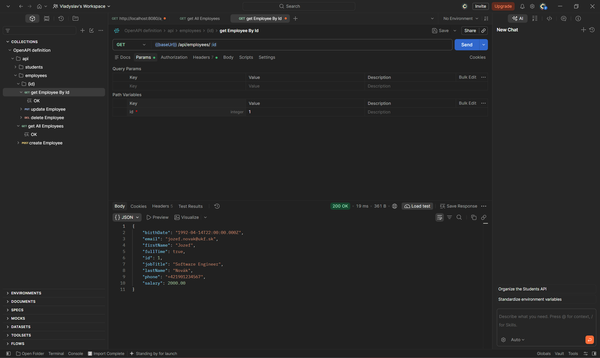

- 3. Pridanie nového zamestnanca (`POST /api/employees`)
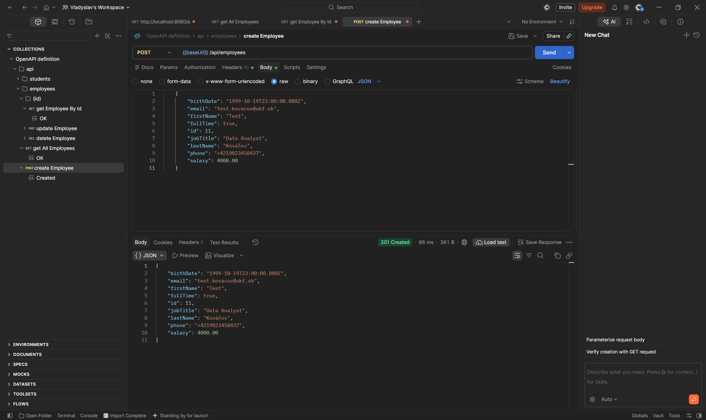

- 4. Aktualizácia zamestnanca (`PUT /api/employees/{id}`)
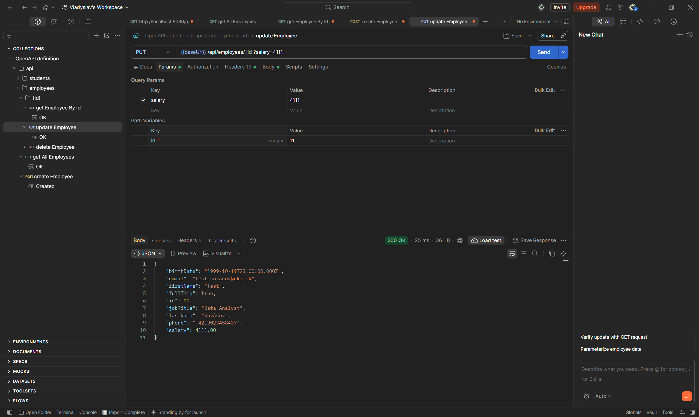

- 5. Zmazanie zamestnanca (`DELETE /api/employees/{id}`)
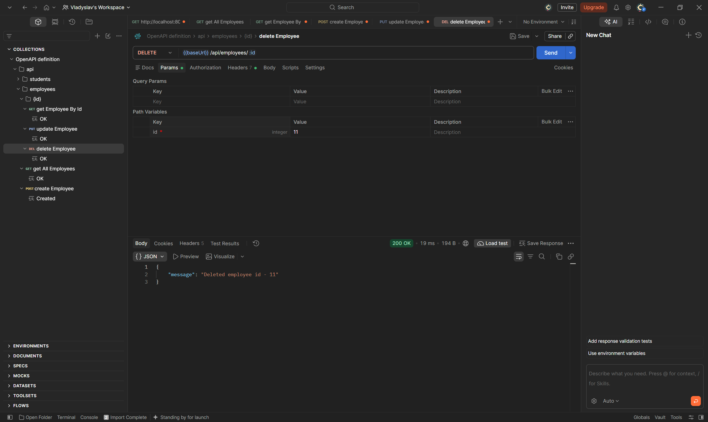

---